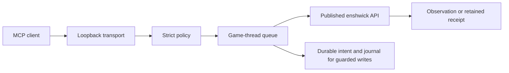

# Architecture and safety

A loopback HTTP listener admits an MCP request, strict policy validates its arguments, and the server queues game work through `Scheduler::next_tick`. The listener never touches the world. The `policy` crate keeps security-relevant rules testable without a running game; `transport` contains HTTP/MCP admission without world access.

## Authority

The server binds `127.0.0.1` only and rejects browser-origin traffic. Remote use goes through an authenticated tunnel. Optional bearer authentication is independent of administrative write admission. Neither a client UI event nor a held-input bit grants server authority.

A real write requires `ALLOW_WRITES` in the mod folder, less than 30 minutes old, plus exact `confirm: "server-write"`. Future-dated or non-regular flags fail the shared write-flag validation. A dry report does not authorize a later real call. Remove the flag after the controlled operation session. Do not restart a shared server while players are connected, and do not mistake an empty-player snapshot for a reconnection barrier.

## Construction lifecycle

1. Survey a quiescent isolated site and preview exact geometry.
2. Resolve one original connected actor, current rights, persistence and observed source voxel.
3. Reserve an exclusive durable operation identity and sync intent/baseline records before native commit.
4. Retain the typed transaction ID before recording the commit outcome.
5. Poll `building_operation` and independently verify all modified bricks, including untouched cells and geometric props.
6. Explicitly accept the verified result or request guarded undo.

At most one construction operation remains unsettled. Acceptance syncs a record before allowing another operation and retains its native receipt. Undo of accepted work refuses other unsettled work and requires its exact expected postimage, including for one cell. Successful undo settles after exact baseline verification. Overlapping later layers therefore require reverse-order recovery.

Identical canonical replay reconciles the retained operation. A changed request under the same ID is refused. After restart, durable identities remain stale and native IDs are never reconstructed. Reservations that failed partway remain blocked rather than becoming a reason to place again.

A native transaction can span simulation steps. It has no placement compare-and-swap and is not an atomic job. The framework can absorb foreign edits between repeated writes to a brick; exact expected-image checks are conservative protection, not general concurrent-edit isolation. Keep the site quiescent throughout application and undo. There is no automatic retry, conflict repair or resumable job engine.

## Repositioning lifecycle

`player_reposition` submits one native administrative request for the sole connected living player. The preview binds active session, account, entity, actor generation, observed position and requested target. Join, leave and death observations invalidate old actor contexts. Requested displacement is at most 16 m.

Intent and its exclusive operation marker precede the native call. An issued result may remain `issued_unknown`: the API returns admission, not an arrival receipt. Identical replay returns the stored result and never dispatches again, including after native errors or outcome-journal failure. Existing `players` reads provide subsequent observations, not a causal completion acknowledgement.

Engine free-spot search can adjust the destination by an unpublished amount. This interface proves no complete collision, hazard, arrival or capsule clearance. Returning is another fresh gated request to a reviewed destination, not undo. Orientation preservation is a native request option; camera, velocity, health and other state restoration are not promised. No game role is changed.

## Companion isolation

The companion listener reads copied snapshots. Bounded archive requests run through the published client UI-frame callback; named event handlers copy evidence on the client's simulation thread. Neither route grants server-world reads or mutations on those threads. Snapshots expose age/staleness and bounded history; an event request is not proof of a current selected tab, recipe or production state.

## Recovery boundaries

Capture records geometric voxels and props, not a full gameplay-state backup. Inventories, production, growth, fuel, text, survivor assignments and logic can prevent safe prop removal or be lost by destructive removal. Prop spawning and functional workshop recovery are not implemented. Native construction receipts are session-only. Use verified cold archives for disposable fixtures and preserve unrelated progress; never overwrite a progressed shared world merely to clean up research.

## Queued inventory grant admission (source 0.21.1)

`give_item` still requires explicit `dry: true` for preview. Real grants check the fresh flag/confirmation before queuing and again on the game thread. Actor resolution and native request submission share that handler. A request that has not started after five seconds is cancelled before a late tick can submit it. Started work may finish after the response timeout; observe inventory and journal before retrying.

A synced `give_item_intent` audit record precedes SDK submission. The native callback syncs `give_item_outcome` independently of the HTTP receiver. Each record is capped at 4,096 bytes; intent admission checks an additional 4,096 bytes of outcome headroom against the shared journal limit. This is a capacity check, not reserved storage. A journal failure can leave a native result unknown; mod shutdown may prevent the callback entirely. Removing the flag does not revoke an already submitted SDK request. The returned `request` identifier correlates audit records only: it provides no replay protection or undo, and a new call can grant again.

Source/public checks pass 187 Rust/31 Python tests, Clippy, formatting and both releases. The revoked-flag regression and fake-host late-callback/cancellation tests pass. This patch is not installed or live-tested. Isolated runtime stays server 0.21.0/companion 0.6.1 with writes disabled; companion source 0.7.0 is also awaiting controlled deployment. Connected-client and neutral-namespace acceptance remain pending.

## Copied-data PNG presentation

Server source 0.46.0 adds terrain_image. Its existing bounded voxel reader runs through the game-thread scheduler; the successful result contains copied data only. The listener validates complete cells and renders the diagnostic image through the game-free presentation module. PNG dimensions/bytes are bounded, JSON-shaped image fields are never automatically promoted, and read/validation/encoding failure emits error text without partial image or retry. Existing tools retain their JSON text format. This is not a game-frame/camera API or a new gameplay executor. Installed server remains 0.45.0 until matched cold qualification.
